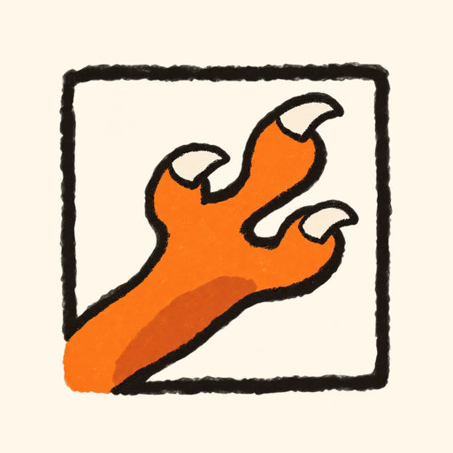

<div align="center">



# ii ne

**macOS 截图、标注与贴图工具** · A native screenshot, annotation and pin-to-screen tool for macOS

[](https://www.apple.com/macos/)
[](https://www.swift.org/)
[]()
[]()
[](LICENSE)

[中文](#中文) · [English](#english)

</div>

---

## 中文

ii ne 是一个用 Swift + AppKit 写的原生 macOS 截图工具，**没有任何第三方依赖**。
它是我按自己每天在用的工作流，对 Snipaste 2 的重新实现（不复用其代码或二进制）。
功能按实际使用取舍，交互尽量贴近 Snipaste。


### 功能

**截图**

- 多屏冻结帧覆盖层，每块屏一个窗口，所见即所得
- 任意方向拖选区，实时显示尺寸
- 悬停窗口显示虚线预览，**单击**吸附整个窗口，**拖动**永远是从落点开始的自由选区
- 开启辅助功能授权后可自动识别 UI 元素（按钮、行、输入框）
- 方向键微调选区，`Ctrl` 扩、`Shift` 缩，按住鼠标时可用 `WASD`
- 八向调整手柄、固定比例（自由 / 1:1 / 4:3 / 16:9 / 16:10 / 3:2）
- `⌥` 放大镜、`C` 取色（`Shift` 切换 Hex / rgb）
- 活动窗口截图、重复上次区域、1–60 秒延时截图
- 白板模式（纯色 / 透明背景）
- 最近截图历史，`,` `.` 翻页回放，**回放时连当时的标注一起还原**

**标注**

- 15 个工具：矩形、圆角矩形、椭圆、直线、箭头、折线、画笔、记号笔、马赛克、矩形马赛克、模糊、放大镜、文字、序号、橡皮擦
- 调色板（含透明度、自定义色、导入导出）、五档笔宽、三种线型、四档背景、箭头单向/双向/反向，样式按工具记忆
- 文字支持多行编辑、四角缩放、旋转
- 撤销 / 重做；选择模式下可移动、缩放、克隆、多选、改样式

**滚动截屏**

- 框选区域后滚动页面，自动逐帧拼接长图
- 自动识别并剔除固定的标题栏 / 底部工具条
- 支持上下双向滚动，结果可直接标注、复制、保存或贴到屏幕

**贴图**

- `F3` 把剪贴板内容贴成置顶窗口：图片、颜色、纯文本、HTML、图片文件路径都支持
- 旋转、翻转、缩放、改透明度、缩略图、中键复位
- 裁剪、灰度、反色、四档背景
- 分组、Solo、多选整组拖动、鼠标穿透
- 贴图上的标注工具与截图**同一套**（15 个工具 + 选中/拖动/删除）
- 关闭贴图再按 `F3` 可恢复，位置、尺寸、变换和**标注**都还原

**输出与识别**

- `Enter` / 双击 / 工具条按钮复制到剪贴板
- `⌘S` 另存为，`⇧` + 保存按钮或 `⌘⇧S` 快捷保存
- 按住 `⌥` 复制成 PNG 文件引用
- 中键或工具条按钮贴到屏幕、系统分享面板、可选阴影留白
- 文字识别与二维码 / 条码识别（Vision，本地离线），结果直接进剪贴板
- 翻译（DeepSeek 或系统翻译）

### 安装

没有预编译的 release，需要自行构建。只需要 Command Line Tools，**不需要完整 Xcode**：

```bash
git clone https://github.com/Yaosc972/ii-ne.git
cd ii-ne
./build.sh install          # 构建并安装到 /Applications 后启动
```

不带参数时只会产出 `Build/ii ne.app` 和 `snip` 命令行工具：

```bash
./build.sh
open "Build/ii ne.app"
```

应用以菜单栏图标方式运行（`LSUIElement`），**没有 Dock 图标**。如果菜单栏图标被系统折叠，
直接从 Finder / 聚焦再打开一次应用，ii ne 会把菜单弹出来。

ii ne 使用自签名，未做公证，也不通过 App Store 分发。

从旧版升级时，首次启动会迁移旧设置和截图历史。已有的新数据优先保留，旧目录保留作兼容。翻译密钥会在首次使用时迁移，旧版唤起链接也可继续使用。应用标识已改名，macOS 可能要求重新授予权限。

### 权限

| 权限 | 用途 | 是否必需 |
| --- | --- | --- |
| 屏幕录制 | 截取屏幕内容 | 必需 |
| 辅助功能 | 自动识别 UI 元素 | 可选 |
| 输入监控 | F1 等功能键的全局监听 | 使用此类快捷键时需要 |

授予屏幕录制后需要**退出并重新启动**应用，TCC 只在全新启动时生效。

### 默认快捷键

| 操作 | 快捷键 |
| --- | --- |
| 截图 | `⌃⇧A` |
| 贴图（剪贴板） | `F3` |
| 显示 / 隐藏全部贴图 | `⇧F3` |
| 切换贴图鼠标穿透 | `⌃⇧T` |
| 截取活动窗口 | `⌃⇧W` |
| 重复上次区域 | `⌃⇧R` |
| 复制选区 | `Enter` 或双击 |
| 另存为 | `⌘S` |
| 快捷保存 | `⇧` + 保存按钮，或 `⌘⇧S` |
| 取消 | `Esc` 或右键 |

快捷键都可以在设置里重新录制。`F1`、`F2`、静音键这类媒体键走 `CGEventTap`——
Carbon 热键收不到被窗口服务器独占的按键。

### 命令行

```bash
snip                          # 开始截图
snip --delay 3                # 3 秒后截图
snip -o clipboard             # 复制最近一次截图
snip -o quick-save            # 快捷保存最近一次截图
snip -o ~/Desktop/a.png       # 保存到指定路径
snip --pos 100 200            # 把最近一次截图贴到指定位置
snip pick-color               # 取色并复制
snip barcode-scan             # 扫描屏幕上的二维码 / 条码
snip show-images              # 显示全部贴图
snip hide-images              # 隐藏全部贴图
snip whiteboard --color red   # 白板模式
```

也可以走 URL scheme：`iine://snip`、`iine://pin` 等。

### 开发与测试

```bash
./build.sh                  # 构建 app 与 CLI
./.env-tools/run-tests.sh   # 单元测试（Swift Testing）
```

端到端验收在 `Tools/verify`，直接驱动真实窗口跑真机流程：

```bash
./Tools/verify/run-p1-e2e.sh            # 截图主流程
./Tools/verify/run-p2-annotate-e2e.sh   # 标注
./Tools/verify/run-p3-pin-e2e.sh        # 贴图
./Tools/verify/run-cli-e2e.sh           # 命令行
./Tools/verify/run-settings-e2e.sh      # 设置
```

当前基线：**352 个单元测试 / 48 个套件**，E2E 覆盖 37 + 98 + 62 + 70 + 32 项。

`build.sh` 兼容只有 Command Line Tools 的环境：存在 `.env-tools/swiftc-manifest` 兼容层时会自动使用。
该目录是本机专用的，已被 gitignore。

### 目录结构

| 路径 | 内容 |
| --- | --- |
| `Sources/IineCore` | 坐标数学、截屏、窗口检测、标注模型与渲染、剪贴板、热键、设置、历史，可单测 |
| `Sources/Iine` | AppKit 外壳：菜单栏、覆盖层、贴图窗口、设置、标注工具条 |
| `Sources/snip` | `snip` 命令行解析与 URL 分发 |
| `Tests/IineCoreTests` | 单元测试 |
| `Tools/verify` | 端到端 harness |
| `Tools/make-app-icon.py` | 从 `Assets/logo-1024.png` 生成 AppIcon 与状态栏图标 |
| `Assets/` | README 与图标母图 |

### 已知限制

- 仅支持 macOS，无自动更新、无云 OCR、无多语言界面
- 长图上限 8000px（约 8 屏，为控制内存峰值）
- 滚动截屏只在本机单屏 + 常见网页上验证过；多屏滚动未验证
- 自签名、未公证，首次运行可能需要在系统设置里放行

### 许可

MIT，见 [LICENSE](LICENSE)。

---

## English

ii ne is a native macOS screenshot tool written in Swift and AppKit, with **no third party
dependencies**. It is a personal reimplementation of Snipaste 2 that follows the workflow I use
every day. It does not reuse Snipaste code or binaries, features are scoped by actual use, and the
interaction model follows Snipaste closely.

### Features

**Capture**

- Multi-display frozen frame overlay, one window per screen
- Drag a selection in any direction with a live size readout
- Hovering a window shows a dashed preview: a **single click** snaps the whole window, while a
  **drag** always starts a free selection at the point you pressed
- Optional UI element detection (buttons, rows, fields) once Accessibility is granted
- Nudge the selection with arrow keys, `Ctrl` to expand, `Shift` to shrink, `WASD` while holding
  the mouse button
- Eight resize handles, fixed aspect ratios (free, 1:1, 4:3, 16:9, 16:10, 3:2)
- Magnifier with `⌥`, colour picker with `C` (`Shift` switches Hex and rgb)
- Active window capture, repeat last region, delayed capture (1–60 s)
- Whiteboard mode with a solid or transparent background
- Capture history with `,` and `.`, replayed full screen **with the annotations from that shot**

**Annotate**

- 15 tools: rectangle, rounded rectangle, ellipse, line, arrow, polyline, brush, marker, mosaic,
  mosaic rectangle, blur, magnifier, text, serial number, eraser
- Palette with alpha, custom colours and JSON import/export; five pen widths, three line styles,
  four background modes, single/double/reversed arrow heads; style is remembered per tool
- Multiline text with corner scaling and rotation
- Undo and redo, plus a select mode for moving, resizing, cloning and multi-selecting shapes

**Scrolling capture**

- Select a region and scroll: frames are stitched into one long image automatically
- Fixed headers and footers are detected and trimmed
- Works in both directions; the result can be annotated, copied, saved or pinned

**Pin windows**

- `F3` pins the clipboard as an always-on-top window: images, colours, plain text, HTML and image
  file paths all work
- Rotate, flip, scale, change opacity, thumbnail mode, middle click to reset
- Crop, grayscale, invert, four background modes
- Groups, solo mode, multi-select and group drag, mouse click-through
- The same 15 annotation tools as the capture overlay, plus select, move and delete
- Close a pin and press `F3` again to restore it with its position, size, transform **and
  annotations**

**Output and recognition**

- `Enter`, double click or the toolbar to copy
- `⌘S` for the save panel, `⇧` on the save button or `⌘⇧S` for quick save
- Hold `⌥` while copying to put a PNG file on the clipboard instead
- Middle click or the toolbar to pin, system share sheet, optional shadow margin
- Text recognition and QR / barcode scanning through Vision, fully on device
- Translation through DeepSeek or the system translator

### Install

There is no prebuilt release; build it yourself. Command Line Tools are enough, **Xcode is not
required**:

```bash
git clone https://github.com/Yaosc972/ii-ne.git
cd ii-ne
./build.sh install          # build, install into /Applications and launch
```

Without arguments the script only produces `Build/ii ne.app` and the `snip` CLI:

```bash
./build.sh
open "Build/ii ne.app"
```

The app runs as a menu bar item (`LSUIElement`) with **no Dock icon**. If the menu bar item gets
folded away by macOS, open the app once more from Finder or Spotlight and ii ne pops its menu.

ii ne is self-signed, not notarized, and not distributed through the App Store.

On the first launch after upgrading, ii ne imports the previous settings and screenshot history. Existing data in the new location takes priority, and the previous directories are retained. The translation credential migrates on first use, and previous app links continue to work. macOS may request permissions again for the renamed app identifier.

### Permissions

| Permission | Used for | Required |
| --- | --- | --- |
| Screen Recording | capturing the screen | yes |
| Accessibility | UI element detection | optional |
| Input Monitoring | global listening for function keys such as F1 | required for these shortcuts |

Grant Screen Recording, then **quit and relaunch** the app: TCC only applies it on a fresh launch.

### Default shortcuts

| Action | Shortcut |
| --- | --- |
| Capture | `⌃⇧A` |
| Pin clipboard | `F3` |
| Hide or show all pins | `⇧F3` |
| Toggle pin click-through | `⌃⇧T` |
| Capture active window | `⌃⇧W` |
| Repeat last region | `⌃⇧R` |
| Copy selection | `Enter` or double click |
| Save panel | `⌘S` |
| Quick save | `⇧` on save, or `⌘⇧S` |
| Cancel | `Esc` or right click |

Every shortcut can be re-recorded in Settings. Media keys such as `F1`, `F2` and mute go through a
`CGEventTap`, because Carbon hotkeys never receive events for keys owned by the window server.

### Command line

```bash
snip                          # start a capture
snip --delay 3                # capture after 3 seconds
snip -o clipboard             # copy the latest capture
snip -o quick-save            # quick save the latest capture
snip -o ~/Desktop/a.png       # save the latest capture to a path
snip --pos 100 200            # pin the latest capture at a position
snip pick-color               # pick a pixel colour and copy it
snip barcode-scan             # scan a barcode on screen
snip show-images              # show all pin windows
snip hide-images              # hide all pin windows
snip whiteboard --color red   # whiteboard mode
```

A URL scheme is available too: `iine://snip`, `iine://pin` and friends.

### Development and tests

```bash
./build.sh                  # build the app and the CLI
./.env-tools/run-tests.sh   # unit tests (Swift Testing)
```

End to end suites live in `Tools/verify` and drive real windows on screen:

```bash
./Tools/verify/run-p1-e2e.sh            # capture
./Tools/verify/run-p2-annotate-e2e.sh   # annotation
./Tools/verify/run-p3-pin-e2e.sh        # pin windows
./Tools/verify/run-cli-e2e.sh           # command line
./Tools/verify/run-settings-e2e.sh      # settings
```

Current baseline: **352 unit tests across 48 suites**, plus 37 + 98 + 62 + 70 + 32 end to end checks.

`build.sh` works with Command Line Tools only: when a local `.env-tools/swiftc-manifest`
compatibility shim exists it is picked up automatically. That directory is machine specific and
gitignored.

### Project layout

| Path | Contents |
| --- | --- |
| `Sources/IineCore` | coordinate math, screen capture, window detection, annotation model and renderer, clipboard, hotkeys, settings, history — unit testable |
| `Sources/Iine` | AppKit shell: menu bar, overlay windows, pin windows, settings, annotation toolbar |
| `Sources/snip` | the `snip` command line parser and URL dispatcher |
| `Tests/IineCoreTests` | unit tests |
| `Tools/verify` | end to end harnesses |
| `Tools/make-app-icon.py` | builds AppIcon and the status bar icons from `Assets/logo-1024.png` |
| `Assets/` | logo masters and README images |

### Known limitations

- macOS only; no auto updater, no cloud OCR, no localization
- Long images are capped at 8000px (about 8 screens) to bound memory
- Scrolling capture was only verified on a single internal display and common web pages; multi
  display scrolling is untested
- Self-signed and not notarized, so the first launch may need to be allowed in System Settings

### License

MIT, see [LICENSE](LICENSE).
